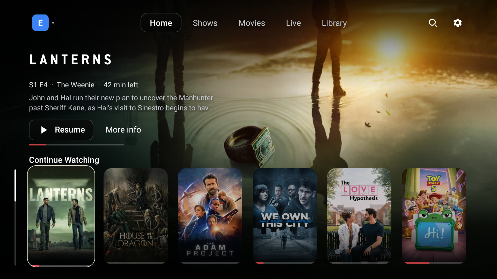
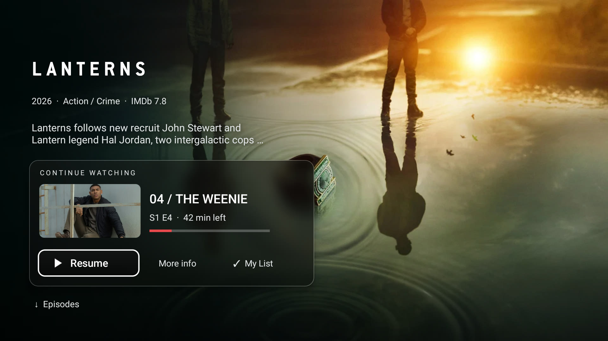

<h1 align="center">Alder</h1>

<p align="center">
  A custom Stremio client for Android TV. Your account and add-ons, with a far better viewing experience.
</p>

<p align="center">
  <a href="https://github.com/aradhyas8/Alder/releases/latest"></a>
  
  <a href="LICENSE"></a>
</p>

<p align="center">
  
  
</p>

Alder is built on top of Stremio. Your account, add-ons, library and watch progress stay exactly where they are, and everything you do in Alder syncs back to Stremio on your phone and computer. What's new is the app you watch in: made for a TV and a remote, quick to open, and quiet enough that the film is the main thing on screen.

## Highlights

- **Press Play, it plays.** Alder picks the best source for your TV and starts it. If a stream fails or shows no picture, it moves to the next one from the same second. Hold OK when you want to choose.
- **Picks up where you left off.** Resume reaches for the same release you were watching, and the next episode prefers the same release group, so quality and audio don't change mid-season.
- **Knows your TV.** Files your TV can't decode are left out before you see them, including Dolby Vision profiles it can't show. Higher quality than your screen or HDR on a screen without it goes down the list.
- **A profile for everyone.** Up to 5 profiles, each its own Stremio account with its own history and recommendations, and an optional PIN.
- **Continue Watching on the Google TV home screen.** Jump straight back into a show without opening the app first.
- **A cinematic interface.** Full-screen art, title logos and rows that open fast because they remember the last visit.
- **The player you'd want.** Skip intro, Up next with autoplay, audio and subtitle choice in one panel, subtitles from add-ons like OpenSubtitles with size, background and timing controls, DTS and TrueHD audio, and frame-rate matching.
- **Manage add-ons on the TV.** Add by URL, reorder and remove. Changes save to your Stremio account.

## How it compares

| | Alder | Stremio for Android TV |
|---|---|---|
| Your Stremio account, add-ons and library | Yes | Yes |
| Watch progress synced with your other devices | Yes | Yes |
| Profiles, each with its own account and PIN | **Yes** | No |
| Starts the best playable source in one press | **Yes** | You choose from the list |
| Moves to the next source when one fails | **Yes, from the same second** | No |
| Skips files the TV can't play | **Yes** | No |
| Skip intro | **Yes** | No |
| Torrent streaming | No, debrid add-ons only | Yes |
| Built for | **A TV and a remote** | Shared with desktop and web |

## Requirements

- Android TV or Google TV running **Android 8.0 (Oreo) or newer**
- A Stremio account with stream add-ons (debrid, for example through AIOStreams)
- A way to sideload an APK: the *Downloader* app, a USB drive with a file manager, or `adb`

## Installation

1. Download the latest APK from the [Releases](https://github.com/aradhyas8/Alder/releases/latest) page.
2. Install it on your TV with the Downloader app, a USB drive and a file manager, or `adb install Alder-<version>.apk`.
3. Open **Alder**, name your profile and sign in to Stremio with the code on screen.

## Privacy

Alder has no analytics, no ads and no account of its own. It talks to Stremio, to the add-ons you installed, to image hosts for artwork, and to [IntroDB](https://introdb.app) for intro times. Profiles and their PINs stay on the TV.

## Building from source

```sh
git clone https://github.com/aradhyas8/Alder.git
cd Alder
./gradlew assembleRelease
```

The APK is written to `app/build/outputs/apk/release/`.

## Credits

Alder borrows from open-source projects:

- [NuvioTV](https://github.com/tapframe/NuvioTV) (GPL-3.0): player setup, profiles, Watch Next, skip intro
- [Just Player](https://github.com/moneytoo/Player) (Unlicense): frame-rate matching, audio passthrough, subtitle styling
- [stremio-core](https://github.com/Stremio/stremio-core) (MIT): library format, sync and Continue Watching rules
- [AndroidX Media](https://github.com/androidx/media) (Apache-2.0): ExoPlayer

Alder is not affiliated with Stremio.

## License

Copyright (C) 2026 aradhyas8

Alder is free software, released under the [GNU General Public License v3.0](LICENSE).
